# Benchmarking de Clasificación de Patrones mediante Regresión Logística: C++ (Eigen) vs. Python (Scikit-Learn)

**Proyecto final 2 – Redes Neuronales**

**Integrantes:** ____________________, ____________________, ____________________, ____________________

**Fecha:** ____________________

## Resumen

Este trabajo implementa un clasificador binario de imágenes de dígitos manuscritos (MNIST, dígito 3 contra dígito 8) usando regresión logística, y compara una implementación de alto nivel en Python (Scikit-Learn y NumPy) contra una implementación de bajo nivel en C++ con la biblioteca Eigen. Se midieron tiempo de entrenamiento, tiempo de predicción, consumo de memoria y métricas de clasificación (exactitud, precisión, recall y F1), y se realizó un estudio de localidad espacial y temporal de la caché en la versión C++. Con el mismo algoritmo (gradiente descendente por mini-lotes, mismos hiperparámetros y precisión float32), ambas implementaciones obtienen resultados idénticos (exactitud 96,88 %, F1 0,9681; diferencia máxima entre pesos de 2,2·10⁻⁶), pero C++ entrena **3,3 veces más rápido** y usa **4,4 veces menos memoria**. Sin embargo, el baseline L-BFGS de Scikit-Learn, un optimizador de segundo orden, entrena 1,7 veces más rápido que el gradiente descendente en C++, lo que muestra que la elección del algoritmo puede pesar más que la del lenguaje. El estudio de localidad muestra que recorrer la matriz en el orden de su almacenamiento es 6,4 veces más rápido que recorrerla a contrapaso, y que los mini-lotes de 32–256 imágenes, que caben en la caché L2, minimizan el tiempo por época.

## 1. Introducción

La regresión logística es el modelo lineal de clasificación binaria más usado y es, además, la unidad básica de una red neuronal: una neurona con activación sigmoide entrenada con entropía cruzada es exactamente una regresión logística. Por eso es un buen caso de estudio para comparar dos formas de llevar un modelo de aprendizaje automático a código:

- **Alto nivel (Python):** bibliotecas como Scikit-Learn y NumPy permiten entrenar un modelo en pocas líneas. El cálculo pesado ocurre en código compilado (C, Cython, BLAS), pero el control del flujo pasa por el intérprete.
- **Bajo nivel (C++):** se escribe el algoritmo completo con control explícito sobre los tipos de datos, la disposición en memoria y el paso de parámetros, apoyándose en Eigen para el álgebra lineal vectorizada (SIMD).

**Objetivo general.** Desarrollar un sistema que procese un dataset de imágenes con regresión logística y comparar el rendimiento (precisión y tiempo de ejecución) entre Scikit-Learn (Python) y una implementación optimizada en C++ con Eigen.

**Objetivos específicos.**

1. Realizar un análisis exploratorio del dataset (distribución de píxeles, correlación entre características).
2. Establecer un baseline con Scikit-Learn.
3. Implementar en C++/Eigen la función sigmoide y el gradiente descendente, gestionando la memoria con punteros y referencias.
4. Analizar la localidad espacial y temporal de la caché al procesar las imágenes.
5. Comparar tiempo de entrenamiento, consumo de memoria y métricas de clasificación.

## 2. Marco teórico

### 2.1 Regresión logística

Dada una imagen representada como un vector de características x ∈ ℝ^d (d = 784 píxeles), el modelo estima la probabilidad de la clase positiva como:

```
p(y = 1 | x) = σ(wᵀx + b),        σ(z) = 1 / (1 + e^(−z))
```

donde w ∈ ℝ^d son los pesos y b el sesgo. La función sigmoide σ convierte cualquier valor real en una probabilidad entre 0 y 1. La clase predicha es 1 si p ≥ 0,5.

### 2.2 Función de pérdida y gradiente

Los parámetros se ajustan minimizando la entropía cruzada binaria promedio con regularización L2:

```
L(w, b) = −(1/n) Σ [ yᵢ log pᵢ + (1 − yᵢ) log(1 − pᵢ) ] + (λ/2) ‖w‖²
```

Esta función es convexa, así que cualquier método de descenso bien configurado llega al mismo mínimo global. Su gradiente tiene una forma matricial compacta:

```
∇w L = (1/n) Xᵀ (p − y) + λ w          ∂L/∂b = (1/n) Σ (pᵢ − yᵢ)
```

El cálculo dominante son dos productos matriz–vector: **z = Xw** (propagación hacia adelante) y **g = Xᵀe** (retropropagación del error e = p − y). Cada uno recorre la matriz X completa, lo cual es determinante para el análisis de caché.

### 2.3 Optimizadores

- **Gradiente descendente por mini-lotes (GD):** w ← w − η ∇w L, calculando el gradiente sobre bloques de m imágenes consecutivas. Es de primer orden, sencillo y barato por iteración, pero necesita muchas iteraciones.
- **L-BFGS** (por defecto en `LogisticRegression` de Scikit-Learn): método cuasi-Newton que aproxima la curvatura (información de segundo orden) con las últimas actualizaciones del gradiente. Necesita muchas menos pasadas sobre los datos.
- **SGD** (`SGDClassifier`): gradiente estocástico muestra a muestra con tasa de aprendizaje decreciente.

### 2.4 Jerarquía de memoria y localidad

El procesador no lee bytes sueltos de la RAM, sino **líneas de caché de 64 bytes** (16 valores float32). El procesador usado (AMD Ryzen 5 5500U) tiene por núcleo 32 KiB de caché L1d y 512 KiB de L2, y 4 MiB de L3 por complejo de núcleos. Acceder a la RAM cuesta del orden de 100 veces más que acceder a L1.

- **Localidad espacial:** si se accede a una dirección, es probable que se acceda pronto a las vecinas. Recorrer la memoria contiguamente aprovecha los 64 bytes de cada línea cargada y activa el *prefetcher* de hardware.
- **Localidad temporal:** si se accede a un dato, es probable que se vuelva a usar pronto. Reutilizar un bloque mientras sigue en caché evita volver a traerlo de la RAM.

Eigen permite almacenar una matriz en orden **RowMajor** (cada fila contigua) o **ColMajor** (cada columna contigua, el orden por defecto). Como cada imagen es una fila de X, el orden RowMajor guarda cada imagen como un bloque contiguo de 3136 bytes.

## 3. Metodología

### 3.1 Dataset (Fase A)

Se usó **MNIST** (LeCun et al.), descargado en su formato IDX original. Para obtener un problema binario no trivial se eligieron los dígitos **3 (clase 0) y 8 (clase 1)**, un par que se confunde con frecuencia porque comparten la mitad derecha del trazo. El par 0 contra 1, en cambio, es casi linealmente separable (>99,9 %) y no permitiría distinguir diferencias entre modelos. Se mantuvo la partición estándar de MNIST:

| Conjunto | Imágenes | Dígito 3 (y=0) | Dígito 8 (y=1) |
|---|---|---|---|
| Entrenamiento | 11 982 | 6 131 | 5 851 |
| Prueba | 1 984 | 1 010 | 974 |

Cada imagen de 28×28 se aplanó en un vector de 784 características y se normalizó a [0, 1] dividiendo entre 255. El script `prepare_data.py` guarda los datos en un `.npz` para Python y en archivos binarios (cabecera int32 de filas y columnas + datos float32 en orden row-major) que C++ lee directamente sobre el buffer de la matriz de Eigen, sin conversiones.

### 3.2 Análisis exploratorio (Fase A)

El script `eda.py` usa Pandas, Matplotlib y Seaborn para analizar el balance de clases, la distribución de intensidades, la imagen promedio por clase, la varianza por píxel, la correlación entre píxeles y con la etiqueta, y una proyección PCA. Los resultados se presentan en la sección 4.1.

### 3.3 Implementación en Python (Fase A)

Se entrenaron tres modelos en `baseline.py`:

1. **`sklearn_lbfgs`:** `LogisticRegression(solver="lbfgs")`, el **baseline** pedido.
2. **`sklearn_sgd`:** `SGDClassifier(loss="log_loss")`.
3. **`numpy_gd`:** clase `NumpyLogisticRegression` escrita a mano con NumPy, con **exactamente el mismo algoritmo, orden de los lotes, hiperparámetros y tipo de dato (float32)** que la versión C++. Este modelo permite comparar lenguaje contra lenguaje sin que intervenga la diferencia de algoritmos.

La regularización es equivalente en todos los modelos: Scikit-Learn minimiza C·Σ logloss + ½‖w‖², así que se usó C = 1/(λn) para que coincida con la pérdida de la sección 2.2.

### 3.4 Implementación en C++ (Fase B)

**Arquitectura y fases de desarrollo.** El proyecto se organiza con CMake, que Qt Creator abre de forma nativa, y sigue la separación clásica de C++ entre declaraciones (`include/*.hpp`) e implementaciones (`src/*.cpp`):

| Módulo | Responsabilidad |
|---|---|
| `dataset.hpp/.cpp` | Tipos de datos (`RowMatrix`, `Vector`, `Dataset`) y carga binaria |
| `logistic_regression.hpp/.cpp` | Motor matemático: clase `LogisticRegression` (sigmoide, pérdida, gradiente, `fit`, `predict`) |
| `metrics.hpp/.cpp` | Matriz de confusión, exactitud, precisión, recall y F1 |
| `utils.hpp/.cpp` | Cronómetro (`std::chrono::steady_clock`), memoria (`/proc/self/status`), estadísticas |
| `main.cpp` | Ejecutable `logreg`: entrena, evalúa, mide y exporta JSON/CSV |
| `locality_benchmark.cpp` | Ejecutable de la Fase C: experimentos de localidad |

Los cuatro primeros módulos se compilan una sola vez como biblioteca estática (`logreg_core`) que enlazan ambos ejecutables. La compilación se hace en modo *Release* con `-O3 -march=native`, lo que habilita las instrucciones AVX2 y FMA del procesador; Eigen las detecta y vectoriza automáticamente. Para comparar de forma justa con Python, se definió `EIGEN_DONT_PARALLELIZE` (un solo hilo) y en Python se fijó `OMP_NUM_THREADS=OPENBLAS_NUM_THREADS=1`.

**Tipos de datos y clases de almacenamiento.** Se usa `float` (32 bits) en todo el proyecto: reduce a la mitad el ancho de banda de memoria frente a `double`, duplica el número de valores por registro SIMD (8 por registro AVX) y es suficiente para este problema. Los datos se guardan en `Eigen::Matrix<float, Dynamic, Dynamic, RowMajor>`, con memoria dinámica en el *heap* alineada para SIMD; la memoria se libera sola al destruir el objeto (RAII), sin `new`/`delete` manuales. Los hiperparámetros van en un `struct` con duración automática (pila), y los buffers de trabajo son miembros de la clase, así que viven lo mismo que el modelo.

**Motor matemático.** El paso de gradiente sobre un mini-lote se escribe con la API de Eigen casi igual que la fórmula:

```cpp
auto z = z_buf_.head(m);                  // vista sobre un buffer preasignado
z.noalias() = Xb * w_;                    // z = Xb w      (sin temporales)
z.array() += b_;
sigmoid_inplace(z);                       // z = σ(z) = 1/(1+e^{-z}), vectorizado
z -= yb;                                  // z = p − y
grad_buf_.noalias() = Xb.transpose() * z; // g = Xbᵀ (p − y)
grad_buf_ *= 1.0f / m;
grad_buf_ += hp_.l2 * w_;
w_ -= hp_.lr * grad_buf_;
b_ -= hp_.lr * z.mean();
```

La sigmoide se implementa en forma vectorizada como `(1 + (−z).exp()).inverse()`. Para z muy negativo, e^(−z) se desborda a +∞ y el resultado es exactamente 0, sin producir NaN en IEEE-754.

**Gestión de memoria: punteros y referencias.**

- **Referencias constantes con `Eigen::Ref`:** `fit`, `predict` y `loss` reciben `const Eigen::Ref<const RowMatrix>&`. No se copia la matriz, y la misma función acepta tanto la matriz completa como un **bloque** de ella.
- **Bloques sin copia:** cada mini-lote es `X.middleRows(start, m)`, una *vista* de filas consecutivas. En orden RowMajor es un trozo contiguo de memoria, así que se pasa sin copiar.
- **Buffers preasignados:** `z_buf_` y `grad_buf_` se reservan una sola vez al inicio de `fit()`. Dentro del bucle de entrenamiento no hay ninguna reserva de memoria dinámica, lo que evita fragmentación y llamadas a `malloc`.
- **`.noalias()`:** le indica a Eigen que el destino no se solapa con los operandos, así que el producto se escribe directo en el buffer sin crear una matriz temporal.
- **Punteros crudos:** la carga del archivo lee directamente sobre `M.data()` (puntero al bloque contiguo de la matriz), y los núcleos manuales del estudio de localidad recorren X con aritmética de punteros (`X + i*d`).
- **Retorno por valor con NRVO/movimiento:** `load_matrix` devuelve la matriz por valor; el compilador construye el resultado directamente en el destino, sin copiar los 36 MB.

### 3.5 Protocolo de medición (Fase C)

- **Hiperparámetros comunes:** η = 0,5, 200 épocas, mini-lotes de 256 imágenes recorridos en orden, λ = 10⁻⁴, pesos iniciales en cero. En cada época se calcula la pérdida sobre todo el conjunto de entrenamiento (en ambos lenguajes).
- **Tiempo:** cada modelo se entrena 5 veces y se reporta la media y la desviación estándar del tiempo de `fit` (`time.perf_counter` en Python, `std::chrono::steady_clock` en C++). El tiempo de predicción es sobre las 1984 imágenes de prueba.
- **Memoria:** pico de memoria residente del proceso (RSS, `VmHWM`/`ru_maxrss`), desglosado en: proceso + bibliotecas cargadas, carga de datos y memoria extra durante el entrenamiento. En Python cada modelo corre en un subproceso independiente para que las mediciones no se contaminen.
- **Localidad:** cada experimento se ejecuta 15 veces tras una ejecución de calentamiento y se reporta la mediana.

**Entorno:** AMD Ryzen 5 5500U (6 núcleos / 12 hilos, se usa 1 hilo), Arch Linux (kernel 7.2), g++ 16.2.1, Eigen 5.0.1, CMake, Qt Creator 20; Python 3.14.8, NumPy 2.5.5, Scikit-Learn 1.9.1, Pandas 3.1.1.

## 4. Resultados

### 4.1 Análisis exploratorio

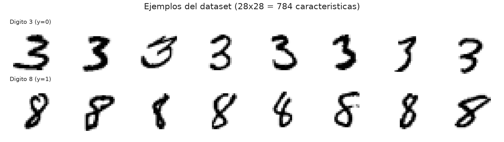

Las clases están **balanceadas** (48,8 % de ochos en entrenamiento y 49,1 % en prueba), así que la exactitud es una métrica representativa y no hace falta reponderar las clases.

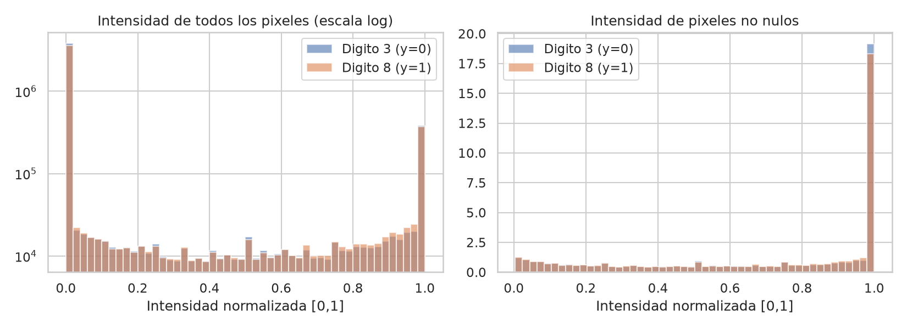

El **78,5 % de los píxeles valen 0** (fondo) y 161 de los 784 píxeles son cero en todas las imágenes de entrenamiento (los bordes). Los píxeles con tinta se concentran cerca de 1. La intensidad media es 0,146. Esta dispersión explica por qué el modelo puede asignar peso casi nulo a los bordes.

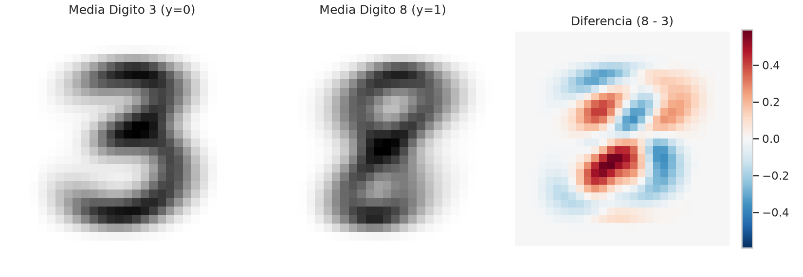

La diferencia entre las imágenes promedio muestra **dónde se distinguen las clases**: el 8 tiene tinta en el lado izquierdo de ambos lazos (rojo), mientras que el 3 tiene sus extremos abiertos más a la izquierda y abajo (azul). Esta es la información que el modelo lineal debe aprender.

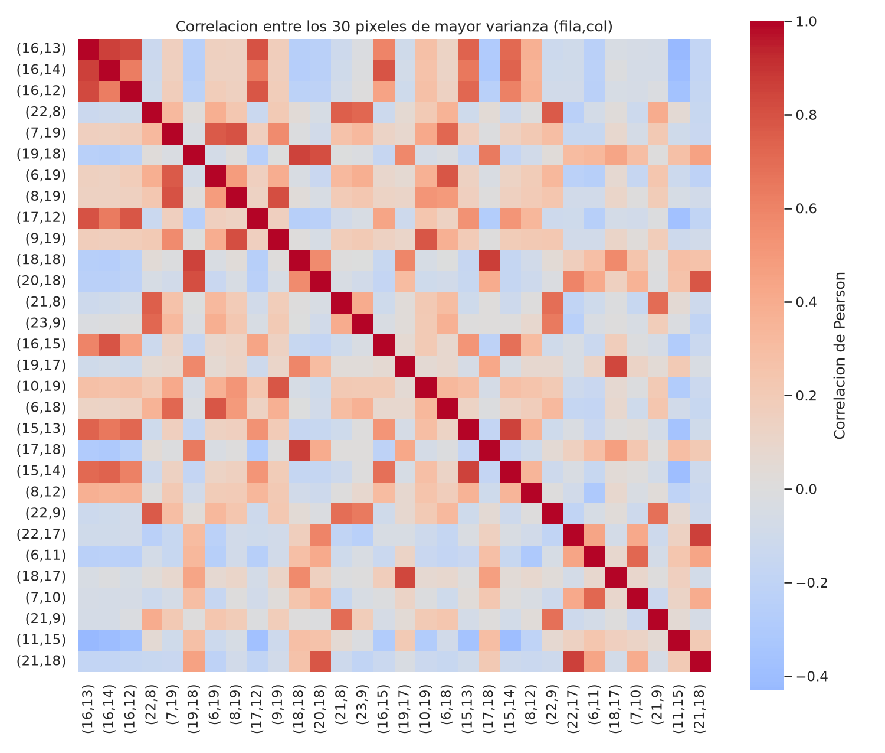

Entre los 30 píxeles de mayor varianza hay **correlaciones fuertes entre píxeles vecinos** (bloques rojos cerca de la diagonal), lo que indica redundancia: las 784 características no son independientes. La correlación píxel–etiqueta alcanza 0,69 en valor absoluto, así que hay píxeles individuales muy informativos.

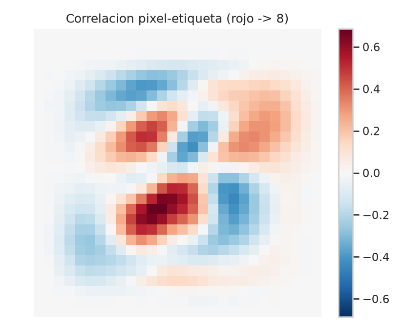

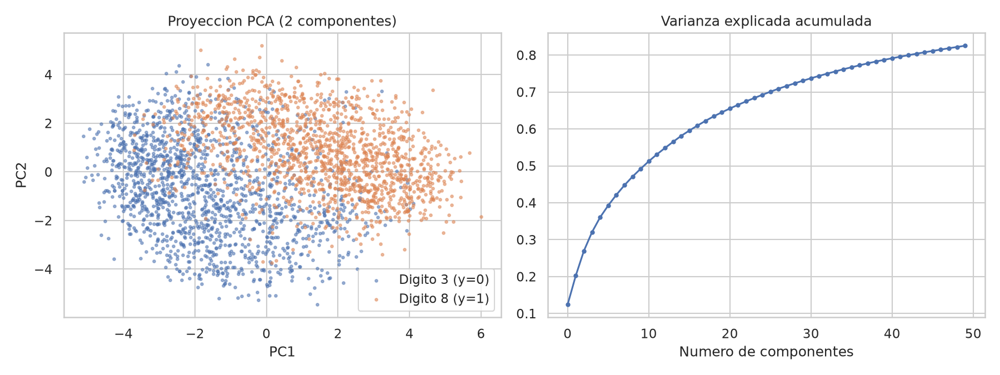

En la proyección PCA, las dos primeras componentes solo explican el 20,2 % de la varianza y las clases se solapan parcialmente; con 50 componentes se explica el 82,5 %. El problema **no es separable en 2 dimensiones**, pero sí aproximadamente separable en el espacio completo, lo que anticipa una exactitud alta pero no perfecta para un modelo lineal.

### 4.2 Métricas de clasificación

| Modelo | Exactitud | Precisión | Recall | F1 |
|---|---|---|---|---|
| Scikit-Learn L-BFGS (baseline) | 0,9672 | 0,9681 | 0,9651 | 0,9666 |
| Scikit-Learn SGD | 0,9657 | 0,9660 | 0,9641 | 0,9651 |
| Python/NumPy GD (manual) | 0,9688 | 0,9711 | 0,9651 | 0,9681 |
| **C++/Eigen GD** | **0,9688** | **0,9711** | **0,9651** | **0,9681** |

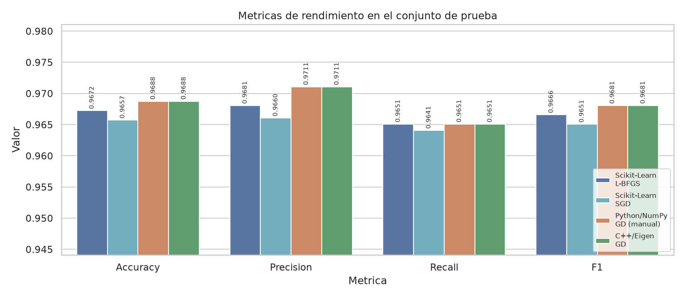

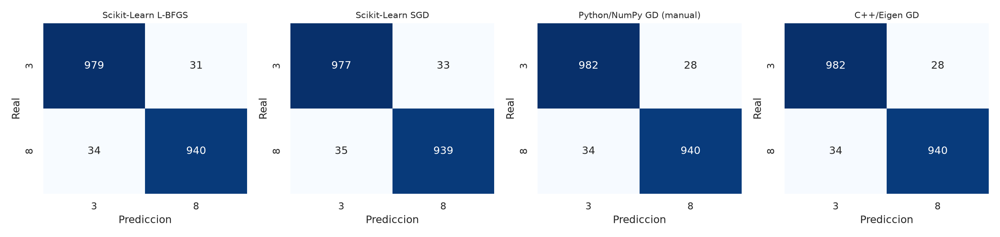

Todos los modelos están entre 96,6 % y 96,9 % de exactitud. Las diferencias son de 1 a 5 imágenes sobre 1984, dentro de lo esperable entre optimizadores que paran en puntos ligeramente distintos del mismo mínimo convexo. **La implementación en C++ reproduce exactamente a la de NumPy**: misma matriz de confusión (982 VN, 28 FP, 34 FN, 940 VP), pérdidas finales que difieren en 3·10⁻⁷, pesos con correlación 0,9999999999996 y diferencia máxima de 2,2·10⁻⁶ (redondeo de float32 por el distinto orden de las sumas con SIMD). Esto **valida la implementación de bajo nivel**. La exactitud en entrenamiento (97,6–97,8 %) es apenas superior a la de prueba, así que no hay sobreajuste relevante.

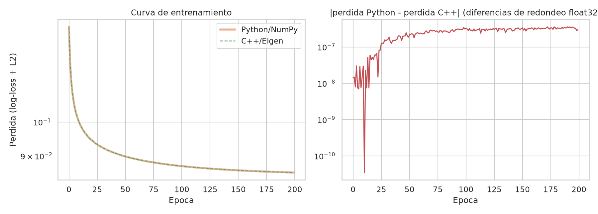

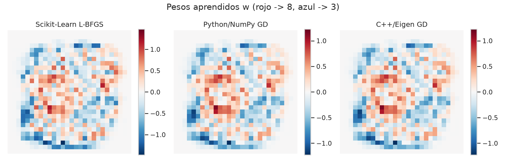

Los pesos aprendidos, vistos como imagen, reproducen la diferencia de medias del EDA: positivos (rojo) donde el 8 cierra sus lazos y negativos (azul) donde el 3 tiene sus extremos.

### 4.3 Tiempo de ejecución

| Modelo | Entrenamiento (s) | Predicción (ms) |
|---|---|---|
| Scikit-Learn L-BFGS | 0,588 ± 0,021 | 1,84 |
| Scikit-Learn SGD | 1,863 ± 0,009 | 1,72 |
| Python/NumPy GD | 3,363 ± 0,045 | 0,60 |
| **C++/Eigen GD** | **1,028 ± 0,040** | **0,47** |

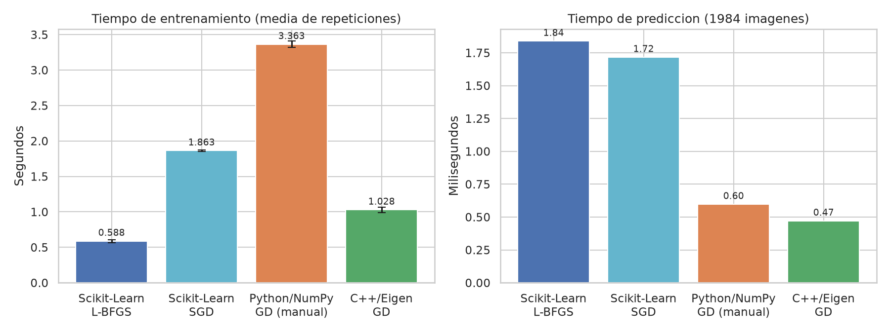

- **Mismo algoritmo (NumPy GD contra C++ GD): C++ es 3,27 veces más rápido.**
- C++ GD es 1,81 veces más rápido que `SGDClassifier`.
- **L-BFGS de Scikit-Learn es 1,75 veces más rápido que C++ GD.** No es una ventaja del lenguaje sino del algoritmo: L-BFGS convergió en 88 iteraciones, mientras que GD hizo 200 épocas × 47 mini-lotes = 9400 pasos de gradiente.
- En predicción, C++ (0,47 ms) es 3,9 veces más rápido que Scikit-Learn (1,84 ms), cuyo `predict` añade validación de entradas y conversión de tipos en cada llamada.

**¿De dónde viene la ventaja de C++ con el mismo algoritmo?** El barrido de tamaño de lote lo explica:

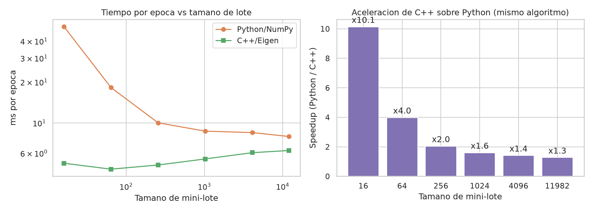

| Lote | NumPy (ms/época) | C++ (ms/época) | Aceleración |
|---|---|---|---|
| 16 | 51,3 | 5,06 | ×10,1 |
| 64 | 18,2 | 4,58 | ×4,0 |
| 256 | 10,0 | 4,91 | ×2,0 |
| 1024 | 8,7 | 5,44 | ×1,6 |
| 4096 | 8,5 | 6,05 | ×1,4 |
| 11 982 (completo) | 8,0 | 6,28 | ×1,3 |

En NumPy cada mini-lote implica unas diez llamadas desde el intérprete (producto, sigmoide, resta, transpuesta, media...), cada una con un costo fijo de algunos microsegundos y con arreglos temporales nuevos. Con lotes pequeños hay cientos de lotes por época y **el costo del intérprete domina** (×10). Con lotes grandes casi todo el tiempo se va en los productos matriz–vector, que NumPy ya ejecuta en C optimizado (OpenBLAS), y la diferencia baja a ×1,3. La ventaja que queda se debe a que C++ no crea temporales y fusiona operaciones elemento a elemento.

### 4.4 Consumo de memoria

| Modelo | Proceso + bibliotecas (MB) | + Datos (MB) | Extra entrenamiento (MB) | **Pico RSS (MB)** |
|---|---|---|---|---|
| Scikit-Learn L-BFGS | 160,0 | 43,4 | 4,8 | **208,2** |
| Scikit-Learn SGD | 160,0 | 43,5 | 2,5 | **206,0** |
| Python/NumPy GD | 160,0 | 43,5 | 2,4 | **205,9** |
| **C++/Eigen GD** | **4,1** | **42,0** | **0,4** | **46,5** |

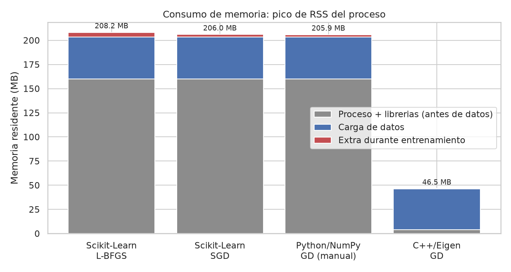

Los datos ocupan prácticamente lo mismo en ambos lenguajes (≈ 42 MB en float32), porque NumPy y Eigen almacenan arreglos contiguos sin sobrecosto por elemento. La diferencia de **4,4 veces** en el pico de memoria se debe casi por completo al **costo fijo del entorno de Python**: intérprete + NumPy + SciPy + Scikit-Learn ocupan 160 MB antes de cargar un solo dato, frente a 4 MB de un ejecutable C++. Durante el entrenamiento, C++ solo necesita 0,4 MB adicionales (pesos, gradiente y buffers preasignados), mientras que Python necesita entre 2,4 y 4,8 MB por los arreglos temporales que crea en cada operación.

### 4.5 Estudio de localidad (Fase C)

**E1 – Localidad espacial.** Se calculó el gradiente g = Xᵀe con bucles manuales sobre la misma matriz RowMajor, cambiando solo el orden de los bucles:

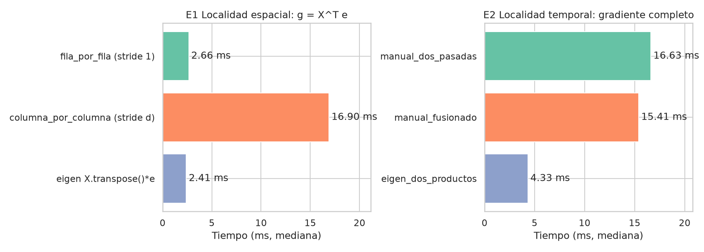

| Variante | Mediana (ms) |
|---|---|
| Fila por fila (paso 1, contiguo) | 2,66 |
| Columna por columna (paso de 784 floats) | 16,90 |
| Eigen `X.transpose() * e` | 2,41 |

Recorrer por columnas es **6,4 veces más lento**, aunque hace exactamente las mismas operaciones aritméticas. Entre dos accesos consecutivos hay 3136 bytes de distancia: cada línea de caché de 64 bytes se trae de memoria para usar solo 4 bytes (6 % de aprovechamiento), y el *prefetcher* no anticipa bien el patrón. Recorrido por filas, cada línea aporta 16 valores útiles y el bucle interno se vectoriza con AVX2. Eigen, que conoce la disposición RowMajor, elige el recorrido correcto automáticamente.

**E2 – Localidad temporal.** El gradiente completo necesita leer X dos veces: para z = Xw y para g = Xᵀe. La versión **fusionada** procesa cada imagen xᵢ una sola vez: calcula zᵢ y acumula eᵢ·xᵢ mientras la fila (3 KB) sigue en la caché L1. Así fue **8 % más rápida** que la versión de dos pasadas. La ganancia es modesta porque, sin `-ffast-math`, el compilador no puede reordenar la suma del producto punto para vectorizarla, y ese cuello de botella aritmético oculta parte del ahorro de memoria. Eigen (dos pasadas, pero con productos explícitamente vectorizados) es 3,6 veces más rápido que ambas versiones manuales: **la vectorización SIMD importa tanto como la localidad**.

**E3 – Tamaño de mini-lote.** Dentro de cada mini-lote, el bloque Xb se lee dos veces (adelante y atrás). Si cabe en caché, la segunda lectura sale de la caché y no de la RAM:

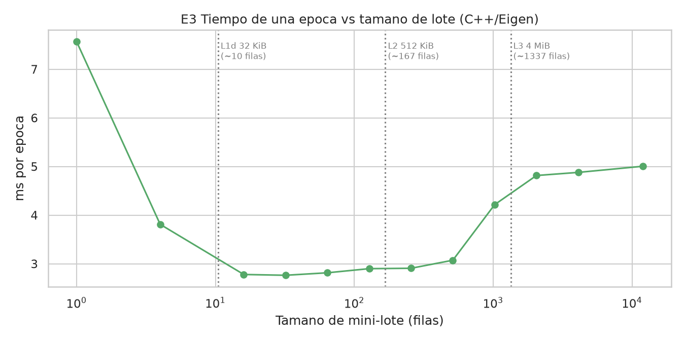

Con lotes de 1 a 4 imágenes, el costo fijo por lote (llamadas, actualización de w) domina. Entre 16 y 256 filas (50 KB – 800 KB, del orden de la L2) el tiempo es mínimo (≈ 2,8 ms/época). A partir de 1024 filas (3,2 MB) el bloque deja de caber en L2/L3 y la segunda lectura vuelve a la RAM: el tiempo sube cerca de un 75 % (≈ 4,9 ms). **El tamaño de lote no es solo un hiperparámetro estadístico: también es una decisión de rendimiento de caché.** El lote de 256 elegido está en la zona óptima.

**E4 – Orden de almacenamiento.**

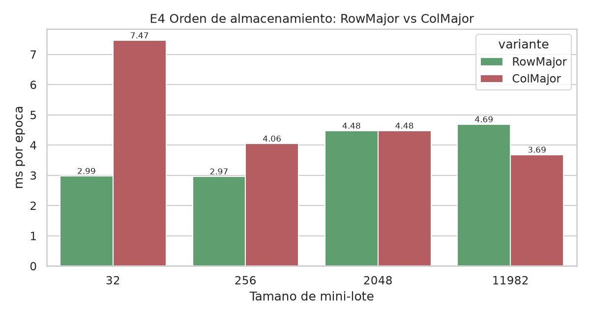

| Lote | RowMajor (ms) | ColMajor (ms) |
|---|---|---|
| 32 | 2,99 | 7,47 |
| 256 | 2,97 | 4,06 |
| 2048 | 4,48 | 4,48 |
| 11 982 | 4,69 | 3,69 |

Con lotes pequeños, **RowMajor es 2,5 veces más rápido**: un mini-lote son filas consecutivas, que en RowMajor forman un bloque contiguo, mientras que en ColMajor cada lote son 784 fragmentos de 32 floats dispersos por los 36 MB de la matriz. Con lote completo ColMajor gana ligeramente, porque el producto Xᵀe sobre toda la matriz recorre columnas contiguas y Eigen tiene núcleos muy eficientes para ese caso. **El orden de almacenamiento debe elegirse según el patrón de acceso del algoritmo**; con mini-lotes, RowMajor es la elección correcta.

**E5 – Paso de parámetros.**

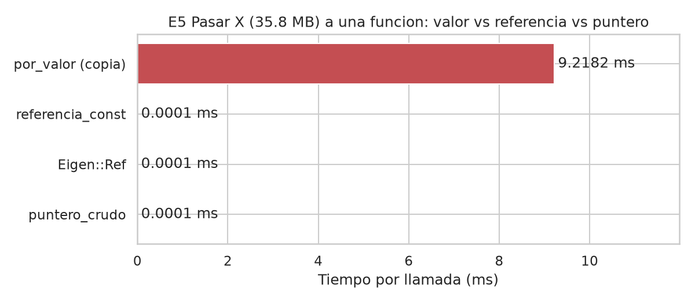

Pasar la matriz de 36 MB **por valor** cuesta 9,2 ms por llamada (copia completa, reserva de memoria y liberación). Por **referencia constante, `Eigen::Ref` o puntero** el costo es inmedible (< 0,001 ms): solo se pasa una dirección. Si el entrenamiento hubiera pasado X por valor en cada paso de gradiente (9400 pasos), habría agregado unos 87 segundos, 84 veces el tiempo total de entrenamiento actual.

## 5. Análisis comparativo

### 5.1 Rendimiento

| Criterio | Python (Scikit-Learn / NumPy) | C++ (Eigen) |
|---|---|---|
| Exactitud / F1 | 96,7–96,9 % / 0,967–0,968 | 96,9 % / 0,968 (idéntico a NumPy) |
| Entrenamiento, mismo algoritmo | 3,36 s | **1,03 s (×3,3)** |
| Entrenamiento, mejor opción disponible | **0,59 s (L-BFGS)** | 1,03 s (GD) |
| Predicción | 0,60–1,84 ms | **0,47 ms** |
| Memoria pico | 206–208 MB | **46,5 MB (×4,4 menos)** |

La precisión no depende del lenguaje: depende del modelo y del optimizador. El tiempo y la memoria sí favorecen a C++ cuando se compara el mismo algoritmo, pero la ventaja algorítmica de L-BFGS (disponible en Python con una línea) supera la ventaja del lenguaje.

### 5.2 Facilidad de implementación

| Aspecto | Python | C++ |
|---|---|---|
| Entrenar el baseline | 2 líneas (`LogisticRegression().fit(X, y)`) | — |
| Algoritmo GD completo | 35 líneas efectivas | 92 líneas efectivas (clase + cabecera) |
| Proyecto completo | ~850 líneas (incluye EDA y gráficas) | ~810 líneas (incluye benchmarks) |
| Carga de datos | `np.load` (1 línea) | Lector binario propio (≈ 30 líneas) |
| Métricas | `sklearn.metrics` | Implementación propia |
| Gráficas y EDA | Pandas / Matplotlib / Seaborn | No disponible: se exportan CSV/JSON para graficar en Python |
| Compilación | No requiere | CMake, flags de optimización, dependencia de Eigen |
| Depuración | Interactiva (REPL, notebooks) | Ciclo editar–compilar–ejecutar; errores de plantillas de Eigen largos y difíciles de leer |
| Tiempo de desarrollo estimado | Horas | Días |

### 5.3 Ventajas y desventajas

**Python / Scikit-Learn**

- ✔ Desarrollo muy rápido; ecosistema completo (optimizadores avanzados, validación cruzada, métricas, visualización).
- ✔ Algoritmos de alta calidad listos para usar (L-BFGS fue el más rápido de todos).
- ✔ Ideal para exploración, prototipado y experimentación.
- ✘ Costo fijo del intérprete por operación: penaliza los bucles con muchas operaciones pequeñas (×10 con lotes de 16).
- ✘ Alto consumo base de memoria (160 MB de entorno).
- ✘ Poco control sobre la disposición de memoria y los arreglos temporales.

**C++ / Eigen**

- ✔ 3,3 veces más rápido con el mismo algoritmo y hasta 10 veces con lotes pequeños.
- ✔ 4,4 veces menos memoria; ejecutable autónomo, apropiado para sistemas embebidos o de tiempo real.
- ✔ Control total sobre la localidad: orden de almacenamiento, buffers preasignados, cero copias.
- ✔ Eigen ofrece una sintaxis cercana a la matemática con vectorización SIMD automática.
- ✘ Más código y más tiempo de desarrollo; hay que implementar desde cero lo que Python ya trae (métricas, carga de datos, gráficas).
- ✘ Compilación, gestión de dependencias y errores de compilación complejos.
- ✘ Un error de diseño en memoria (recorrer a contrapaso, pasar por valor) puede anular toda la ventaja: el lenguaje no garantiza el rendimiento por sí solo.

## 6. Conclusiones y recomendaciones

1. **Ambas implementaciones son correctas y equivalentes.** Con el mismo algoritmo, C++/Eigen y NumPy obtienen la misma matriz de confusión, las mismas métricas (exactitud 96,88 %, F1 0,9681) y pesos que difieren en menos de 2,2·10⁻⁶. La regresión logística logra casi el 97 % al distinguir 3 de 8, un par difícil para un modelo lineal.
2. **C++ es más rápido y más eficiente en memoria con el mismo algoritmo:** 3,3 veces en entrenamiento y 4,4 veces menos memoria. La ventaja crece hasta 10 veces cuando el algoritmo hace muchas operaciones pequeñas (lotes pequeños), porque desaparece el costo del intérprete.
3. **El algoritmo importa más que el lenguaje.** L-BFGS en Scikit-Learn entrenó 1,7 veces más rápido que GD en C++. Antes de reescribir en C++ conviene elegir el mejor optimizador.
4. **La localidad de memoria determina el rendimiento real.** Recorrer la matriz en el orden de su almacenamiento fue 6,4 veces más rápido; elegir RowMajor para mini-lotes, 2,5 veces; y pasar por referencia en vez de por valor evita copias de 36 MB. Mini-lotes de 32–256 imágenes, que caben en caché, minimizan el tiempo por época.
5. **Vectorización y localidad se complementan:** los bucles manuales con buena localidad siguieron siendo 3,6 veces más lentos que Eigen, que aprovecha AVX2/FMA.

**Recomendaciones.**

- Para **exploración, prototipado y entrenamiento** de modelos clásicos, usar Python/Scikit-Learn: es más productivo y ofrece optimizadores superiores.
- Para **inferencia en producción, sistemas embebidos o de baja latencia**, o cuando el algoritmo no existe en bibliotecas y requiere bucles finos, usar C++/Eigen con: almacenamiento acorde al patrón de acceso, paso por referencia (`Eigen::Ref`), buffers preasignados, `.noalias()` y compilación con `-O3 -march=native`.
- Un flujo híbrido aprovecha lo mejor de ambos: entrenar en Python y desplegar el modelo (784 pesos + sesgo) en C++.
- **Trabajo futuro:** implementar L-BFGS en C++ para una comparación con el mismo optimizador; evaluar multihilo (OpenMP en Eigen frente a BLAS multihilo); extender a clasificación multiclase (softmax) y a una red neuronal con capa oculta.

## Referencias

1. Müller, A. C., & Guido, S. (2016). *Introduction to Machine Learning with Python*. O'Reilly Media.
2. Guennebaud, G., Jacob, B., et al. *Eigen: a C++ template library for linear algebra*. Documentación oficial: https://eigen.tuxfamily.org
3. Pedregosa, F., et al. (2011). Scikit-learn: Machine Learning in Python. *Journal of Machine Learning Research*, 12, 2825–2830. Documentación: https://scikit-learn.org
4. LeCun, Y., Cortes, C., & Burges, C. J. C. *The MNIST database of handwritten digits*.
5. Drepper, U. (2007). *What Every Programmer Should Know About Memory*. Red Hat, Inc.
6. Nocedal, J., & Wright, S. J. (2006). *Numerical Optimization* (2.ª ed.). Springer. (Método L-BFGS)

## Anexo A. Reproducción de los resultados

```bash
# Dependencias del sistema (Arch Linux)
sudo pacman -S --needed eigen qtcreator cmake gcc python

# Todo el pipeline: datos -> EDA -> Python -> C++ -> localidad -> gráficas
./run_all.sh            # REPS=5 por defecto

# Abrir el proyecto C++ en Qt Creator: File > Open File or Project > cpp/CMakeLists.txt
# (seleccionar el kit en modo Release; los ejecutables buscan los datos en ../data)
```

| Archivo | Contenido |
|---|---|
| `python/prepare_data.py` | Descarga MNIST y exporta el par 3/8 |
| `python/eda.py` | Análisis exploratorio (8 figuras) |
| `python/baseline.py` | Scikit-Learn L-BFGS, SGD y GD manual en NumPy |
| `python/batch_sweep.py` | Barrido de tamaño de lote Python vs C++ |
| `python/compare.py` | Gráficas y tablas comparativas |
| `cpp/src/main.cpp` | Entrenamiento y benchmark C++ |
| `cpp/src/locality_benchmark.cpp` | Experimentos de localidad E1–E5 |
| `results/` | JSON/CSV con todas las mediciones y `figures/` con las gráficas |
